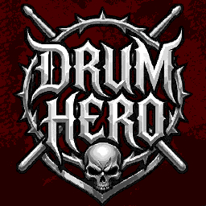

<p align="center">
  
</p>

<h1 align="center">Drum Hero</h1>

<p align="center">
  A mobile rhythm game focused exclusively on the drums.
  <br>
  Play Clone Hero and YARG songs on an 8-lane drum highway, with touch input or a motion-controlled kick pedal.
</p>

<p align="center">
  <a href="LICENSE"></a>
  
  
</p>

---

Drum Hero is a drum-only rhythm game in the spirit of Rock Band, Guitar Hero, Clone Hero and YARG. It plays community song folders as-is: MIDI or `.chart` charts, audio stems, album art and optional `song.ini` metadata.

The game is built with Godot 4.7 and targets Android, with desktop builds used for development and testing.

## Features

- **8-lane drum highway** — Hi-Hat (closed/open), Crash, Snare, Kick, Tom 1, Tom 2, Tom 3 and Ride.
- **Three control modes** — Default (all 8 lanes), Haptic (7 lanes plus a kick played by tilting the device) and Custom (reorder lanes, mirror the layout, left-handed mode).
- **Clone Hero / YARG song support** — `notes.mid` and `notes.chart`, Rock Band drum mappings, Pro Drum tom markers, audio stems and `song.ini`.
- **External song libraries** — scan Downloads, Documents or any custom folder in place; songs do not need to be copied into the app.
- **Menu and progression** — search, album art, song previews, difficulty selection and per-song best scores.
- **Gameplay feedback** — hit windows, combo and multiplier, beat lines, song timeline, long-rest countdowns and a CRASH shockwave.
- **Free Mode** — test pads, lane order, layout and the haptic kick without loading a song.
- **Android integration** — native plugins for gesture exclusion at the screen edges and `MANAGE_EXTERNAL_STORAGE` access.

## Quick start

### Android

1. Install a build from the [Releases](https://github.com/jdpc-dev/drum-hero/releases) page, or build the APK yourself (see [Building from source](#building-from-source)).
2. On Android 11+, grant **All files access** when prompted so the game can scan song folders outside its own storage directory.
3. Copy songs into `DrumHero/` on internal or external storage, or point the game at an existing library in **Settings → Songs → Library locations / Extra folders**.
4. Choose a difficulty and play. Songs are scanned automatically when the menu opens.

### Desktop

Install [Godot 4.7](https://godotengine.org/download), open `project.godot`, and run the project. To launch from a terminal:

```bash
godot --path .
```

On desktop, song folders can be placed in `user://DrumHero` or added through the Songs settings tab.

## How to play

| Lane | Instrument | Keyboard |
|:---:|---|:---:|
| 0 | Hi-Hat (closed/open) | `1` |
| 1 | Crash | `2` |
| 2 | Snare | `3` |
| 3 | Kick | `4` |
| 4 | Tom 1 | `5` |
| 5 | Tom 2 | `6` |
| 6 | Tom 3 | `7` |
| 7 | Ride | `8` |

Tap the touch zone at the bottom of each lane on mobile, or press the matching number key on desktop. In **Haptic** mode the Kick lane is hidden and the kick is triggered by a short forward tilt of the device; **Custom** mode lets you reorder lanes and choose whether the kick is haptic.

Scoring uses six timing judgments: **Perfect** (±22.5 ms), **Excellent** (±45 ms), **Good** (±75 ms), **Late** (±100 ms), **Early** (±100 ms) and **Miss** (±135 ms). The windows can be inspected in **Settings → HUD**.

## Song library

A song is any folder whose direct child is `notes.mid` or `notes.chart`:

```text
Songs/<artist> - <song>/
├── song.ini           # optional metadata (title, artist, preview start, song length…)
├── notes.mid          # MIDI chart — preferred
├── notes.chart        # Feedback/.chart chart — used when notes.mid is absent
├── song.ogg           # full mix
├── preview.ogg        # optional short preview (falls back to song.ogg)
├── drums.ogg          # optional stems: drums, bass, guitar, rhythm, keys, vocals
├── album.jpg          # cover art (album.png also supported)
└── background.jpg     # background art
```

`notes.mid` takes priority over `notes.chart`. If a song has no drum track, enable **Settings → Experimental → Use PART GUITAR as fallback** to play the guitar chart as drums.

The scanner also accepts `drums_1.ogg`, `drums_2.ogg`, etc. for multi-file stems. `.opus` audio plays on desktop (via `ffmpeg`), but not on Android — convert it to `.ogg` before loading it on a device:

```bash
tools/convert_opus_to_ogg.sh --remove-opus
```

## Settings

The in-game settings are split into four tabs:

- **Controls** — Default/Haptic/Custom mode, lane order, haptic sensitivity and tuning, mirrored and left-handed layouts.
- **HUD** — FPS counter, screen shake, hit feedback, note speed, countdown threshold and timing windows.
- **Songs** — storage permission, Downloads/Documents presets, extra folders, scan depth, rescan and scan diagnostics.
- **Experimental** — Free Mode, guitar-chart fallback, judgment areas, menu status, haptic debug overlay and Android gameplay padding.

Settings are stored in `user://settings.cfg`; best scores are stored separately in `user://scores.cfg`.

## Building from source

### Requirements

- **Godot 4.7** (standard build, GDScript).
- **Android SDK + JDK 17** for Android exports.
- **ffmpeg** with `--enable-libopus` on desktop if you want to play `.opus` audio.
- Android **Build Template** installed through *Project → Install Android Build Template…*.

### Run and test

```bash
godot --path .
```

Headless test scenes live in `tools/`:

```bash
godot --headless --path . res://tools/test_lanes.tscn
godot --headless --path . res://tools/test_menu_state.tscn
godot --headless --path . res://tools/test_song_end.tscn
godot --headless --path . res://tools/test_song_end_e2e.tscn
```

The full set is `test_freemode`, `test_highscores`, `test_lanes`, `test_libscan`, `test_menu_state`, `test_metadata`, `test_song_end`, `test_song_end_e2e`, `test_songsui` and `test_timeline`.

### Android export

1. Install the Android build template and select **Use Gradle Build** in the Android export preset.
2. Build the native AARs and copy them into the addons:

   ```bash
   cd GestureExclusionPlugin
   ./gradlew :plugin:assembleDebug

   cd ../AllFilesAccessPlugin
   ./gradlew :plugin:assembleDebug
   ```

3. Copy each generated `plugin-debug.aar` to its addon, for example `addons/GestureExclusion/bin/debug/GestureExclusion.aar` and `addons/AllFilesAccess/bin/debug/AllFilesAccess.aar`.
4. Enable both plugins under *Project Settings → Plugins*.
5. Export with the **Drum Hero** Android preset.

See [docs/architecture.md](docs/architecture.md) for the exact plugin paths, toolchain versions, permissions and build troubleshooting.

## Project structure

```text
scene/          Main menu, gameplay, settings, Free Mode and UI scenes
script/
├── autoload/   Singletons: settings, audio, timing, scoring, song loading…
├── chart/      MIDI and .chart parsers plus chart data classes
├── gameplay/   Highway, lanes, notes, hit detection
├── input/      Touch input and haptic kick detection
├── scoring/    Score formatting and high-score data
├── timing/     Judgment evaluation
└── ui/         Menu, HUD, settings and result screens
tools/          Headless tests and audio conversion scripts
docs/           Design specifications and development documentation
addons/         Android plugins (GestureExclusion, AllFilesAccess)
```

## Documentation

Start with the [documentation index](docs/README.md), which lists the recommended reading order. Highlights:

| Document | What it covers |
|---|---|
| [docs/architecture.md](docs/architecture.md) | Runtime scene tree, autoloads, audio pipeline, input, chart formats and build notes (Spanish). |
| [docs/gameplay/01-song-timeline.md](docs/gameplay/01-song-timeline.md) | How every gameplay element stays synchronized to the song clock. |
| [docs/gameplay/02-hit-window.md](docs/gameplay/02-hit-window.md) | Timing windows and judgment behavior. |
| [docs/gameplay/03-beat-lines-system.md](docs/gameplay/03-beat-lines-system.md) | Measure and beat line rendering. |
| [docs/gameplay/05-song-intro-countdown.md](docs/gameplay/05-song-intro-countdown.md) | Countdown before the first note. |
| [docs/gameplay/06-next-notes-countdown.md](docs/gameplay/06-next-notes-countdown.md) | Countdown during long gaps between notes. |
| [docs/input/01-haptic-kick-pedal.md](docs/input/01-haptic-kick-pedal.md) | Accelerometer-based kick detection. |
| [docs/charts/02-drums-difficulty-system.md](docs/charts/02-drums-difficulty-system.md) | How drum difficulties are stored in `.mid` and `.chart` files. |
| [docs/charts/03-rock-band-drums-system.md](docs/charts/03-rock-band-drums-system.md) | 4-lane vs. Pro Drums and tom markers. |
| [docs/charts/04-implementing-notes-chart.md](docs/charts/04-implementing-notes-chart.md) | `.chart` importer specification. |
| [docs/ui-reference.md](docs/ui-reference.md) | ASCII layouts for gameplay, menus, settings and Free Mode. |

## Contributing

Issues and pull requests are welcome. Please keep gameplay changes covered by a headless test in `tools/` when possible, and update the relevant document under `docs/` if behavior or specifications change.

## License

Drum Hero is released under the [GNU General Public License v3.0](LICENSE).
